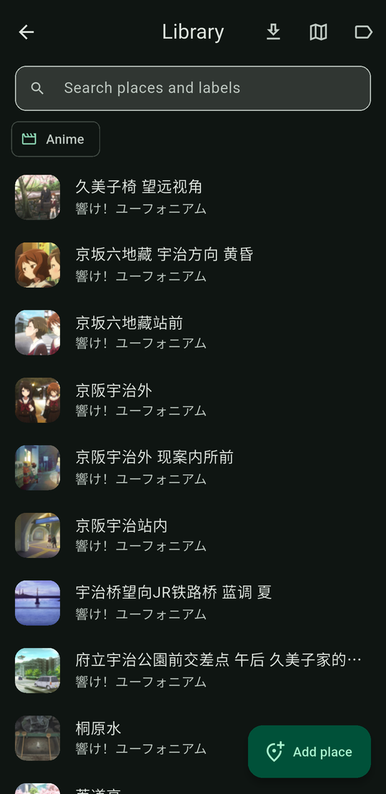
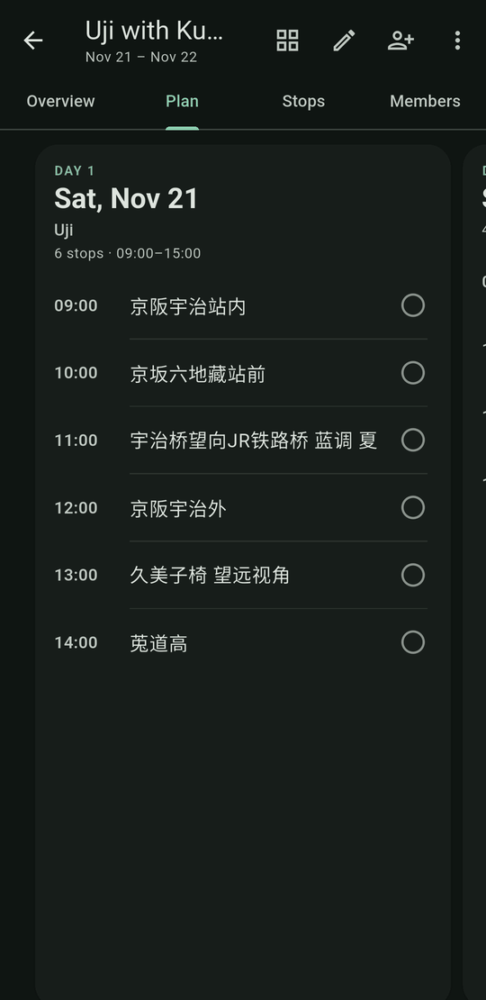
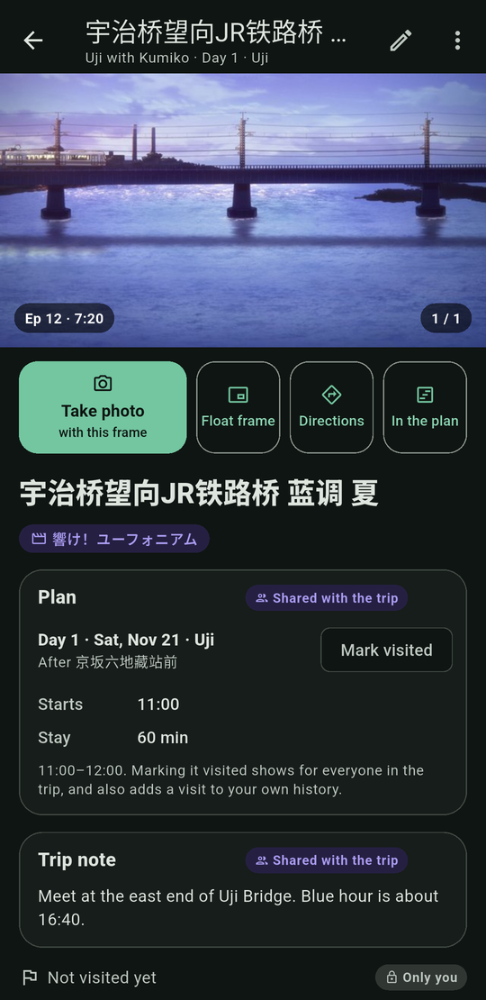
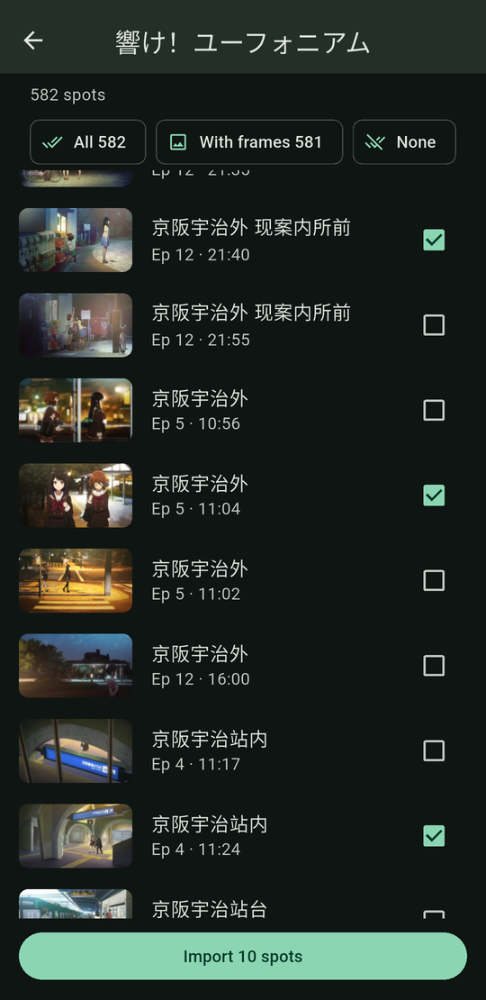
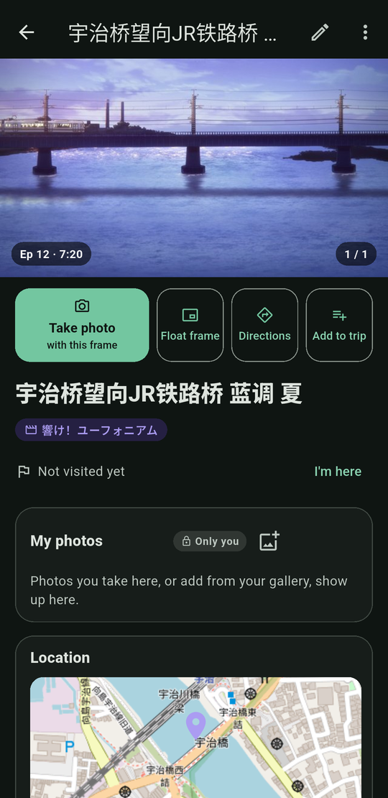
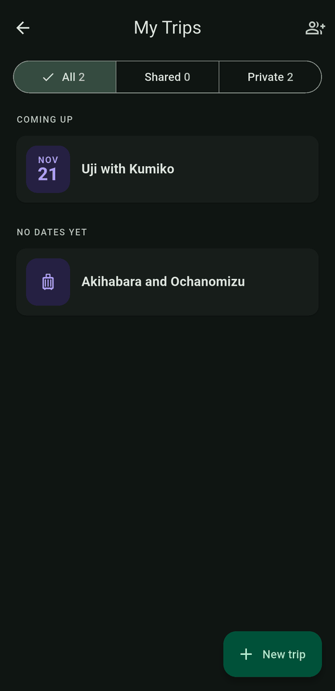
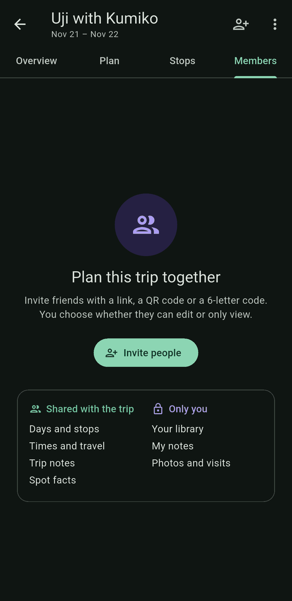

# Anime Pilgrimage Travel Planner

**Plan the trip, then stand where your favorite scene happened.**

Anime Pilgrimage Travel Planner helps you organize *seichi junrei*: real-world visits to the places that inspired the scenes in your favorite anime. Keep a library of the spots you want to see, plan a trip day by day, share it with the friends you travel with, and when you get there, line your camera up with the original frame to recreate the shot.

Your library and your trips live on your phone. **No account is needed, and everything but sharing works offline**, which helps on a rural train platform with one bar of signal. Sign in with Google only when you want to plan a trip together.

<p align="center">
  
  
  
</p>

---

## How it works

1. **Collect places.** Import a whole anime's pilgrimage spots from Anitabi, or add your own on the map. They go into your **library**, labelled by anime, tag and region.
2. **Plan a trip.** Add places to a trip as stops, and arrange them day by day with start times, stays and travel between them.
3. **Plan it together.** Invite friends with a link, a QR code or a 6-letter code. Everyone's changes sync.
4. **Recreate the scene.** At each spot, float the anime frame over your camera, match the framing, and take your own version.

---

## What you can do

- 📚 **Keep a library of places** with their anime frames, labels, facts, your own note, your visits and your photos.
- ⬇️ **Import spots from Anitabi** by searching an anime: pick the spots you want, with their frames and coordinates.
- 🗺️ **See your places on a map**, and find new ones by name, by a Google Maps link or by coordinates.
- 🗓️ **Plan trips day by day**: drag stops between days, set times, keep backup days for rain, and pin a day to a date. Group stops that are close together, or merge ones that are the same spot.
- 👥 **Share a trip** with friends who can edit it or only view it, and see it sync as they change it.
- 📍 **Shoot where you stand**: **Shoot** offers the frames of your places within about 150 m, and the day map shows the day's stops around you.
- 📸 **Recreate scenes with the Anime Camera**, with the frame floating over your camera. On Android it opens your phone's own camera app, so you keep its HDR and night mode.
- 💾 **Back up to a file** and restore it on a new phone: your library, private trips and photos.
- 🎨 **Touch up your shots later**: the photos you keep wait under **Photos to edit**. The photo editor matches the colors to the frame, adjusts brightness and sharpness, rotates, straightens and crops, or pastes a character from the frame into your photo.

---

## Getting around

The **home screen** is a column of cards. Only the top one changes with the date:
- **On a day of a trip**, it's today: the day's stops on a small map (tap it for the day map) and the next stop with **Take photo** and **Mark done**.
- **On other days**, it's your next trip, with **Continue planning**. With no trip, **Plan a pilgrimage**.

Under it, **Photos to edit** shows while there are any, and **Near you** lists up to 3 of your places within 3 km. It asks for your location only when you tap it.

The bar at the bottom has **Trips**, **Shoot** *(Android and iOS)* and **Library**. The **⋮** menu has **Float a frame over any app** *(Android)* and **Edit a photo from the gallery**.

There's no sign-in on the home screen. Sharing, inviting and joining a trip ask you to sign in with Google; **Sign out** is in My Trips' account menu.

---

# User Manual

## 1. Build your library



**Import from Anitabi** is the quickest start:

1. Open **Library** and tap **Import from Anitabi**.
2. Search an anime by its Japanese or Simplified Chinese title, e.g. *響け！ユーフォニアム* or *吹响吧！上低音号*. Traditional Chinese and English titles mostly don't work yet.
3. Pick the series. Its spots load with their anime frames.
4. Every spot starts ticked. Tap **None** and tick the ones you want, or keep **All** or **With frames**.
5. Tap **Import N spots**, then **Save to the library**, or **Save, and add them to a trip**.

Each spot arrives with its coordinates, its frame (with the episode and time), and a label for the anime. Spot names stay as Anitabi's contributors wrote them, often in Japanese or Simplified Chinese; rename a place if you like.

The frames download after you save. If you close the app before they finish, import the same anime again: it fetches only the frames it missed.

> 🌐 Importing needs an internet connection. The spots come from [Anitabi](https://www.anitabi.cn), a community-maintained pilgrimage map shared under [CC BY-NC-SA 4.0](https://creativecommons.org/licenses/by-nc-sa/4.0/), and keep their source. The first import of the day downloads Anitabi's map index (about 2 MB).

**Add a place by hand:** tap **Add place**, then find the spot on the map. Search by name, paste a Google Maps link, or type coordinates such as `34.889, 135.807`. Give it a name and save it. If it looks like a place you already saved, the app offers to use that one instead.

**Find your places:** search names, addresses and labels, filter by anime, tag or region, or switch to the map.

**Change several at once:** hold a place to start picking, then add a label to all of them, add them to a trip, merge them, or remove them from your library. Merging and removing change only your library: your trips keep their stops.

**Labels** (the label button at the top of the Library) lists your anime, tag and region labels. Rename one, merge two, or delete the ones nothing uses.

**Back up to a file:** the Library's **⋮** menu saves your library, private trips and photos as one `.pilgrimage` file and opens the share sheet, so you can keep it in Drive or send it to yourself. On the new phone, install the app, then **⋮** → **Restore from a file** (an empty library offers it too). Restoring only adds what's missing, so it never overwrites newer edits. Shared trips aren't in the file: sign in and they come back.

<br clear="right">

## 2. A place's page



Tap a place to open its page. The anime frames lead; swipe between them.

- **Take photo** opens the Anime Camera with this frame. **Float frame** floats it over other apps *(Android)*. **Directions** opens your maps app.
- **Add to trip** adds the place to a trip as a stop.
- Below: its labels, your visits (**I'm here** records one), what's known about the spot, the trips it's in, **My note**, **My photos** grouped by trip, and its location.
- The **pencil** turns the page into a form: edit the name, facts, labels and your note, then tap **Done**.

My note, your visits and your photos are only yours, even on a shared trip.

<br clear="right">

## 3. Plan a trip



**My Trips** lists your trips under **Ongoing**, **Coming up**, **No dates yet** and **Finished**. Filter them by **All**, **Shared** or **Private**.

1. Tap **New trip**, give it a name, a description if you like (it shows under the name in My Trips), a start date if you know it, and the number of days. The menu's **Edit trip** changes them later.
2. Open the trip. It opens on **Plan**, next to **Stops** and **Members**.
3. On **Stops**, tap **Add stops**: **From my library**, or **New spot** on the map. Places can come from your library, or from the import (**Save, and add them to a trip**).

**Tidy the stops:** Anitabi has one spot per scene, so one café can come in as several stops. On **Stops**, hold a stop to pick several, then:
- **Group** stops that are close together, and name the group. A group shows as one row; open it to rename it or **Ungroup**.
- **Merge** stops that are the same spot. Pick the one to keep; it takes the others' notes, labels, frames and days.

The **map** button at the top of a trip opens its day map (see [On the day](#5-on-the-day)).

<br clear="right">

### The Plan tab


The plan shows one day at a time; swipe between days. The grid button shows every day at once, with the backup days and the **backlog** (stops not on a day yet). Tap the circle next to a stop to mark it visited.

Tap the **pencil** to edit the plan:
- **Hold a stop and drag it** within the day, onto another day (hold it at the screen's edge), or onto the backlog. Undo brings it back.
- **A group** is one block on its day, such as "11:00–13:00 Café Rose · 3 stops", that opens to its stops. Drag its header to move the whole group. To move one stop on its own, tap it and choose **Take out of the group**.
- **Tap a stop** to set its start time, its stay, and the travel time to the next stop, or to **Remove from the trip**. The rest of the day moves with it, and a stop that would start before the one before it ends is marked. Times after midnight read 25:30 and so on.
- **A day's menu** names it ("Uji", "Rainy day"), pins it to a date, moves it to the backup days, or removes it.
- **In the grid**, drop one day on another to swap them.
- **Add Day** and **Add a backup day** come after the last day.

While the trip is under way, the plan opens on today.

<br clear="right">

### A stop's page


Tap a stop to open its page. It looks like a place's page, with the trip's parts on top:
- **Plan**: its day, when it starts, how long you stay, and **Mark visited**, which also adds a visit to your history.
- **Trip note**: a note everyone in the trip sees, such as where to meet.
- **About this spot**: the trip's own copy of the facts. Editing it changes the trip, not your library.
- Then your own note, visits and photos, from your library place.

The **⋮** menu renames the stop, moves it to another day or the backlog, takes it out of its group, or removes it from the trip.

<br clear="right">

## 4. Plan a trip together



Sharing needs a Google sign-in, for you and for the friends you invite.

**Invite:**
1. On a trip, tap the **person-plus** button or open **Members**.
2. Choose **Edit** (add, move and remove stops, change times and trip notes) or **View only** (see the plan as it changes).
3. Tap **Create invite**. You get a **link**, a **QR code** and a **6-letter code**, valid for 7 days. **Share invite** sends the link through any app.

**Join:**
- **Open the link** on an Android phone with the app installed, or **scan the QR code** with your phone's camera.
- Or in **My Trips**, tap **Join a trip** and type the code or paste the link.
- You see the trip, who invited you and what you can do, then tap **Join trip**.

**Once it's shared:**
- **Everyone's changes sync** whenever they're online: days, stops, times, trip notes and the stops' facts. Your library, your notes and your photos stay on your phone.
- **The Members tab** shows who's in the trip. The owner can make someone view only or let them edit, make them the owner, remove them, stop an invite, or **Stop sharing**.
- **Shared trips' cards** in My Trips show the others' avatars, as in "You and Aki" or "You and 3 others".
- **Leave trip** (in the Members tab or the **⋮** menu) takes you out of a trip someone else owns. Only the owner can delete a shared trip.
- Whoever leaves or is removed, or sees the owner stop sharing, **keeps their own copy** of the trip as it was. It just stops syncing.
- **View only** members see the trip with "View only" under its name. They can't change the plan, but their own note and photos still work.
- **A small cloud** next to a shared trip's name means it isn't in sync yet: you're offline, it's still sending, or a change was refused. Tap it to see which.

> 💡 If a link opens in a chat app's browser (LINE, Discord) and the app doesn't open, copy the 6-letter code from the page and enter it under **Join a trip**.

<br clear="right">

## 5. On the day

**The day map** shows a day's stops on a map with your location, the route between them, and how many are visited. Open it from the **map** button at the top of a trip, or from the small map on the home screen. Switch days along the top. Tap a stop for its frame, how far it is and which way, the photos you took there, **Take photo** and **Mark visited**.

**On the home screen**, today's card shows the next stop with **Take photo** and **Mark done**. Undo takes it back. View-only members don't get Mark done.

A shot never marks a stop done: that's always your call.

> 🌐 The map's tiles need a connection. The day's stops and the camera work offline.

## 6. Recreate the scene (Anime Camera)

*Available on Android and iOS.*

1. Tap **Take photo** on a place's or a stop's page, on the day map, or on the home screen's next stop. Or tap **Shoot** on the home screen: it finds where you are and offers the frames of your places within about 150 m, nearest first. On a trip day the day's stops come first, and the rest wait under **Other places nearby**. With one place nearby that has one frame or none, the camera opens after 2 seconds unless you tap **Not this place**. You can also shoot with another place's frames, a picture from your gallery, or no frame.
2. Line it up:
   - **On Android**, your phone's own camera app opens, with the frame floating in a small window. **Drag** the window to move it and **pinch** to resize it. **Tap** it for opacity **−** / **+** and **✕** to close it, which fade away once you leave them. When the spot has several frames, **‹** and **›** switch between them, as in **‹ 3/14 ›**. **Double-tap** it to shrink it to a small dot out of the way; tap the dot to bring it back. The camera's shutter, focus and zoom work everywhere else on the screen.

     The first time, Android asks you to allow Trip Planner to **display over other apps**. If you'd rather not, you can still shoot without the window. On Android 13 and later, if you installed the app from a downloaded APK, Android may only say "App access denied": first turn on **Allow restricted settings** in the app's App info (**⋮** menu). The app's dialog has an **App info** button that opens it.
   - **On iOS**, the frame floats over the in-app camera. Drag it, pinch to resize it, use the **opacity slider**, switch frames with **‹ ›**, and switch **flash**, the **native or fill** framing, **zoom** or the **front camera** as needed.
3. Take the shot.
   - **On Android**, the camera opens again with the frame still where you left it, so you can take a few. Press back in the camera when you're done. Your shots then show beside the frame each was taken with: tap the ones to keep, then **Keep**. They're saved as shot to the place's **My photos**, under the trip you were on that day, and to a **Trip Planner** album on your phone, and wait under **Photos to edit**; the others are deleted. If you can edit the trip, **Mark X done** is offered for a stop on a day (already ticked when every frame of the stop has a shot), or **Add X to Day N** for a place that isn't on one. Each stop shows its progress, such as "2 of 5 frames". **Take more** opens the camera again. If Android closes Trip Planner while the camera is open, your shots come back the next time you open it.
   - **On iOS**, the shot opens in the photo editor with the frame attached.

> 💡 **Float a frame over any app** *(Android)*, in the home screen's **⋮** menu, or **Float frame** on a page, floats a frame over every app until you close it, so you can take as many shots as you like with any camera app.

## 7. Edit your photos

**Photos to edit** (from its card on the home screen) holds the photos you kept as shot and haven't edited yet, by day. Tap one to edit it. **Keep as it is** takes it off the list, with Undo; hold one to pick several.

You can also tap **Edit** on a photo in a place's page, or **Edit a photo from the gallery** in the home screen's **⋮** menu. On iOS the editor also opens after every shot.

- **Tools** run along the bottom; swipe the strip to see them all:
  - **Reference**: add or swap the frame you're matching.
  - **Match Color**: shift your photo's colors toward the frame's.
  - **Brightness** and **Sharpness**.
  - **Rotate**: turn 90°, flip, or straighten up to 45° either way over a grid.
  - **Crop**: free, the frame's shape (**Match ref**), the original shape, or 1:1, 4:3, 3:4, 16:9 and 9:16. The frame floats inside the crop box with its own opacity slider.
  - **Compose**: cut a character out of the frame and paste it into your photo. It downloads its AI model (~176 MB) the first time you tap **Download AI model**.
- **The place button** at the top shows which library place the photo is saved to. Tap it to choose another place or make a new one; **No place** saves the photo only to your phone's gallery.
- **Save** closes the editor right away and finishes in the background. Photos go to the place's **My photos**, under the trip you were on that day, and to a **Trip Planner** album on your phone. Your edits never overwrite the original.

## 8. Coming from v0.1.x

The first time you open v0.2.0 or later, your data moves to the new library:
- **Places (POIs)** become library places, with their notes, reference images, photos and visits.
- **Regions, anime and tags** become labels on those places.
- **The Trip Calendar's schedule isn't carried over**, and regions don't become trips. Make a trip in **My Trips** and add your places to it.
- **Regions synced to the cloud** in v0.1.x stop syncing. Share a trip instead.

---

## Good to know

- **It's yours, and it works offline.** Your library, trips and photos are stored on your phone. No account and no connection needed, except for the things below.
- **What goes online:**
  - importing from Anitabi and searching anime on Bangumi;
  - the maps' tiles (the library's, the day map's and the home screen's) and searching by name (OpenStreetMap);
  - signing in and shared trips (Google Firebase);
  - the photo editor's **Compose**, which downloads its AI model (~176 MB) the first time; use Wi-Fi for that one.
- **Back up before you switch phones.** Shared trips are kept in the cloud, but your library, private trips and photos live only on this phone. Nothing backs up by itself: use **Back up to a file** before switching phones or clearing app data.
- **Where features work:**

  | Feature | Android | iOS | Desktop |
  |---------|:-------:|:---:|:-------:|
  | Library, trips, planner, sharing | ✅ | ✅ | ✅ |
  | Opening invite links in the app | ✅ | — | — |
  | Anime Camera (frame overlay) and Shoot here | ✅ | ✅ | — |
  | Several shots, then pick | ✅ | — | — |
  | Floating Reference | ✅ | — | — |
  | Photo editor | ✅ | ✅ | ✅ (no Compose) |

  On Android, the camera asks once for permission to display over other apps, which the floating frame needs. With an APK you downloaded, turn on **Allow restricted settings** in the app's App info first.

---

<details>
<summary><b>For developers</b>: building from source</summary>

This is a [Flutter](https://flutter.dev) app using Drift (SQLite) for local storage, Riverpod for state management, GoRouter for navigation, and Firebase (Auth, Firestore, Hosting) for sharing.

```bash
# Install dependencies
flutter pub get

# Generate the database & provider code
dart run build_runner build --delete-conflicting-outputs

# Run on a connected device (Android / iOS)
flutter run

# Run on Windows Desktop
flutter run -d windows --dart-define-from-file=env.json

# Run the unit tests
flutter test

# Run the Firestore rules tests on the emulator (needs firebase-tools and Java)
firebase emulators:exec "python test/rules_v2_emulator_test.py" --only firestore --project trip-planner-2775c
```

Source is organized feature-first under `lib/features/` (`library`, `trip`, `planner`, `sharing`, `sync`, `camera`, `anime`, `poi`, `auth`, `home`), with shared infrastructure under `lib/core/` (`database`, `router`, `providers`, `services`). `firestore.rules` holds the cloud rules, and `public/` is the Firebase Hosting site (the invite page, App Links, privacy policy and terms). See `CLAUDE.md` for the architecture and conventions, and `CHANGELOG.md` for release history. GitHub Actions runs the tests and the rules tests on every pull request and builds the APK when a version tag is pushed.

Contributors using Claude Code get three project skills: `run-app` (build, launch, and drive the app on the Android emulator), `verify` (`tool/verify.ps1`: the unit tests with compact output, and the rules tests with `-WithEmulator`), and `release` (version, docs, build, smoke test, and a confirmation checklist before anything is published).

</details>

## Acknowledgements

- Pilgrimage locations and frames come from [Anitabi](https://www.anitabi.cn) and its contributors ([CC BY-NC-SA 4.0](https://creativecommons.org/licenses/by-nc-sa/4.0/)).
- Reading Anitabi's map data follows [MiriaGo](https://github.com/BilyHurington/MiriaGo) (MIT). See [`THIRD_PARTY_NOTICES.md`](THIRD_PARTY_NOTICES.md).
- Anime search uses [Bangumi](https://bgm.tv). Maps and place search use [OpenStreetMap](https://www.openstreetmap.org/copyright) data, © OpenStreetMap contributors.

## License

MIT
